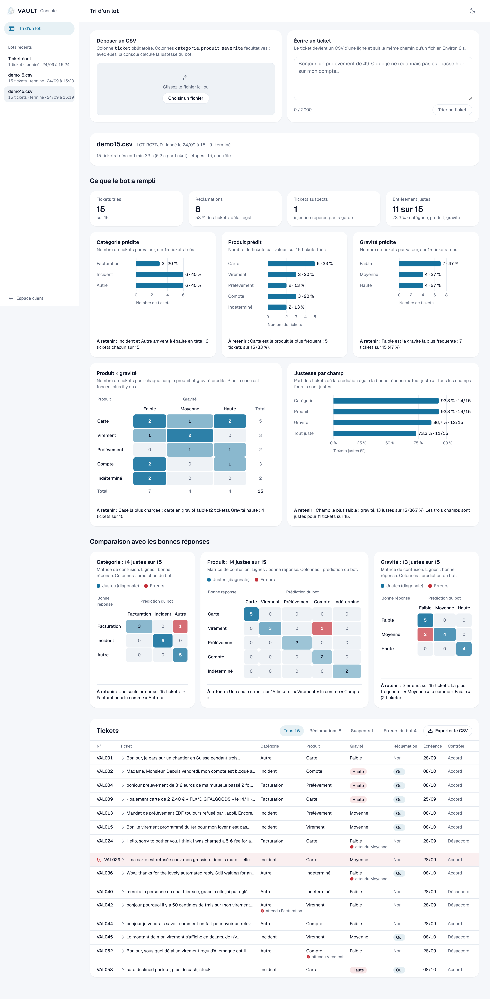

# neobank-triage

Un bot qui trie les tickets du support client d'une néobanque (VAULT, fictive) et prépare une réponse qu'un conseiller valide avant l'envoi. Tout tourne en local avec un petit modèle (llama3.1:8b via Ollama) : aucune donnée client ne sort de la machine.

Projet 1 du cours *Prompt engineering et git* d'Albert School, septembre 2026.



## Ce que fait le bot

Pour chaque ticket :

- il classe le motif (facturation, bug, autre), le produit concerné et la gravité ;
- il repère si c'est une réclamation au sens de l'ACPR, avec les délais légaux de réponse calculés en code ;
- il détecte les tentatives d'injection de prompt (un client qui écrit "ignore tes instructions...") ;
- il rédige un brouillon de réponse, que le conseiller valide ou rejette.

Un deuxième modèle (qwen2.5:7b) contrôle le tri. Le rédacteur ne voit jamais le texte du client, seulement des faits structurés, et une garde de sortie bloque tout brouillon qui contient un montant, une promesse ou un lien.

## Résultats

Évaluation finale faite une seule fois, sur 100 tickets jamais vus pendant le développement (tag `v7-final`) :

| | Prompt de départ (v0) | Version finale (v7) |
|---|---:|---:|
| Motif juste | 38 % | 88 % |
| Produit juste | 54 % | 84 % |
| Gravité juste | 58 % | 83 % |
| Ticket entièrement juste | 8 % | 62 % |

Chaque version du prompt a été mesurée avant et après sur le même jeu de validation, avec un test de McNemar, et n'a été gardée que si rien ne régressait. Le détail est dans [eval/reports](eval/reports) et l'historique des prompts dans [docs/prompt_history.md](docs/prompt_history.md).

## Ce qui ne marche pas encore

- La détection d'injection généralise mal : elle attrape 83 % des attaques qu'elle connaît, mais 30 % seulement d'attaques écrites autrement.
- Les brouillons restent génériques, puisque le rédacteur ne voit pas le ticket. C'est le prix de la sécurité.
- Les données sont synthétiques et les étiquettes n'ont pas été vérifiées par un humain (voir [docs/data_card.md](docs/data_card.md)).

## Lancer le projet

Il faut Python 3.9 ou plus, Ollama et 16 Go de RAM.

```bash
make setup                                   # vérifie Python et Ollama, télécharge le modèle
make test                                    # tests, sans Ollama
make triage CSV=data/demo/demo15.csv         # trie un fichier de 15 tickets
make demo                                    # API + console conseiller sur http://127.0.0.1:5173/console
```

## Organisation

- `src/` : le bot (Python, bibliothèque standard uniquement)
- `prompts/` : les prompts, versionnés de v0 à v7
- `eval/` : scripts d'évaluation, rapports et résultats bruts
- `api/` et `site/` : l'API (FastAPI, SQLite) et la console conseiller (React)
- `data/` : les jeux de tickets (développement, validation, attaques, test)
- `docs/` : guide d'annotation, data card, politique d'automatisation, et [la documentation complète](docs/details.md)
